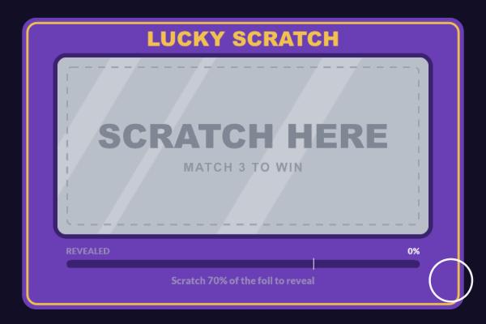
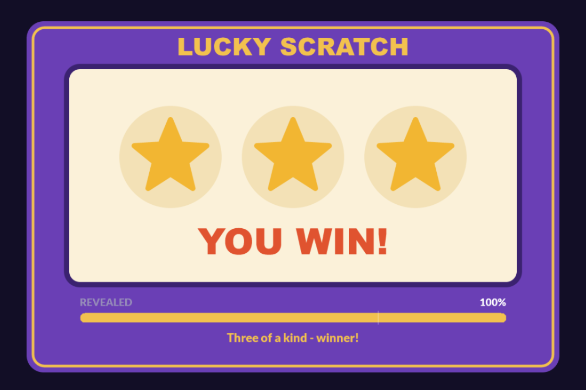
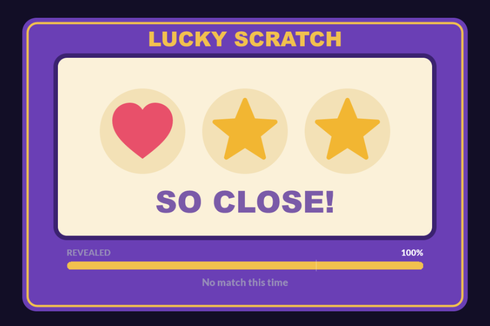
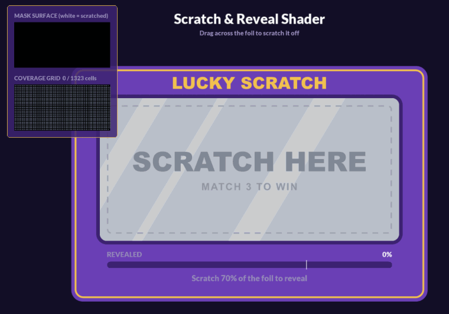

# GameMaker Scratch & Reveal Shader


A drop-in scratch-off effect for GameMaker. Drag across a cover sprite to wipe it away with a soft brush and reveal what's underneath. Progress is tracked live, and once enough is scratched off, the rest of the cover fades away.

**[▶ Play the live demo](https://dannytran-dev.github.io/gamemaker-studio-2-scratcher-shader/)**: works with a mouse or a finger, on desktop and mobile.

<p align="center">
  
</p>

## Features

- **Smooth, soft-edged scratching.** A feathered brush is stamped along each drag, and fast drags still leave an unbroken line.
- **Works with any sprite.** Covers can sit anywhere on a texture page, trimmed or not, and can be any shape. Transparent areas never count towards progress.
- **Live progress for free.** A coverage grid tracks how much has been scratched without reading anything back from the GPU each frame.
- **Auto-reveal.** Once a set share is scratched off (70% by default), the rest fades out and a callback fires.
- **Small touches.** Scratched edges get raised-edge shading, and flakes spray off as you scratch.
- **Survives surface loss.** The scratch mask is backed up to a buffer and rebuilt if the GPU drops it.
- **Sharp on HiDPI and mobile.** It's paired with the [HTML5 Display Scaler](https://github.com/dannytran-dev/gamemaker-studio-2-html-display-scaler), so input stays under the finger at any pixel density or aspect ratio.

| Winning card | Losing card |
|---|---|
|  |  |

## Quick start

### Try the demo
- **In the browser:** open the [live demo](https://dannytran-dev.github.io/gamemaker-studio-2-scratcher-shader/).
- **In GameMaker:** open `gamemaker-studio-2-scratcher-shader.yyp`, choose the **HTML5** target and run.

| Input | Action |
|---|---|
| Drag / touch | Scratch |
| **N** | New card |
| **R** | Reset the card |
| **M** | Show the scratch mask and coverage grid |
| **D** | Show display scaler details |

### Add it to your project
1. Copy the **Scratcher** folder into your project, leaving out **Scratcher / Demo**. Also copy the **Display Scaler** folder, which handles pointer input on HiDPI screens. To use the scratcher without it, set `SCRATCH_POINTER_X/Y` to `mouse_x` / `mouse_y` in `scr_scratcher_config`.
2. Place an `oDisplayScaler` in your first room (it persists between rooms).
3. Create a card:
   ```gml
   card = scratch_card_create(x, y, depth - 1, sFoil, sPrize);
   card.onReveal_ = function() { show_debug_message("Revealed!"); };
   ```
4. Run on the HTML5 target and drag across the card.

### More examples

```gml
// Cover only: scratch a sprite away over whatever is already drawn behind it
card = scratch_card_create(x, y, depth - 1, sDirtyWindow);

// Drive a progress bar
card.onScratch_ = function(_progress) {
	progress = _progress;	// 0-1
};

// Tune this card only (defaults live in scr_scratcher_config)
card.brushRadius_ = 80;
card.revealThreshold_ = 0.5;
card.flakes_ = false;

// Deal the next round
card.set_reveal(sNextPrize);
card.reset();

// Skip straight to the reveal
card.reveal();
```

## How it works

<p align="center">
  
</p>

Press **M** in the demo to see the two things that drive the effect. The **mask surface** (top) decides what gets erased. The **coverage grid** (bottom) measures progress.

```
 pointer held                                                     [Step]
     │  room position → mask pixels
     ▼
 stamp_line(last, now)
     │  brush stamped every radius × SPACING px along the drag
     ├──► mask surface: white brush stamps on black      → what's erased
     └──► coverage grid: cells under the brush core ticked off → progress
                               │
                               ▼  progress ≥ threshold
                          reveal(): onReveal_(), cover fades out

 Draw: reveal sprite, then cover sprite through shd_scratch_reveal  [Draw]
       cover alpha × (1 - mask.r)
```

### The mask
Each card owns a surface the size of the card on screen, cleared to black. The brush is a round texture with a feathered edge, built once and shared by every card. It's stamped in white along each drag. The shader multiplies the cover's alpha by `1 - mask.r`, so soft brush edges fade the cover out gradually instead of cutting it hard. Only colour channels are written, so the mask's alpha never changes.

Strokes are interpolated between frames, so a fast drag leaves an unbroken line instead of a row of dots. Stamps are spaced at a fraction of the brush radius, not every pixel, which keeps long strokes cheap.

### Sprite UVs vs mask UVs
A sprite is usually packed somewhere on a texture page, so its UVs don't run 0–1 the way the mask surface's do. Sampling the mask with the sprite's own UVs only works if the sprite has a texture page to itself. Instead, the card works out a linear mapping from the sprite's UVs (including any trimmed border) to the mask's UVs, and passes it to the shader as `u_maskTransform`. Any sprite works, on any texture page.

### Coverage grid
Progress isn't measured by reading the mask back from the GPU. When the card is set up, the cover is split into `SCRATCH_GRID_CELL` cells. Its alpha is read back once, so cells over transparent parts (rounded corners, holes) are left out. After that, each brush stamp ticks off the cells inside its solid core, so progress is just `cleared / total` and always up to date.

### Edge shading
Cover left next to a scratch is darkened slightly on the side facing away from the light, so the scratched edge looks raised. The shader does this by sampling the mask a few pixels towards the light. `SCRATCH_EDGE_SHADE` sets the strength (0 turns it off) and `SCRATCH_EDGE_WIDTH` sets the width.

### Surface loss
The GPU can throw surfaces away at any time. The mask is copied into a buffer at the end of each stroke and rebuilt from it if the surface disappears.

## API

| Function / method | Description |
|---|---|
| `scratch_card_create(x, y, depth, cover, [reveal], [scale])` | Create a card and set it up |
| `card.setup(cover, [reveal])` | (Re)build the card for a cover sprite. Set `image_xscale/yscale` first |
| `card.set_reveal(sprite)` | Swap the sprite underneath without touching the scratches |
| `card.reset()` | Put the whole cover back |
| `card.reveal()` | Clear the cover now (fades out, fires `onReveal_`) |
| `card.get_progress()` / `card.is_revealed()` | Share scratched off (0–1) / whether the card has been revealed |
| `card.draw_debug_mask(x, y, scale)` / `card.draw_debug_grid(x, y, scale)` | Draw the mask or coverage grid, e.g. in Draw GUI |

| Variable | Default | Description |
|---|---|---|
| `brushRadius_` | `SCRATCH_BRUSH_RADIUS` | Brush radius in room units |
| `revealThreshold_` | `SCRATCH_REVEAL_THRESHOLD` | Progress (0–1) that clears the rest |
| `enabled_` | `true` | False ignores input |
| `flakes_` / `flakeColour_` | `true` / silver | Particles that spray off while scratching |
| `onReveal_` | `undefined` | `function()` called once the threshold is reached |
| `onScratch_` | `undefined` | `function(progress)` called whenever progress changes |

The card is a plain instance, so `x`, `y`, `depth`, `image_alpha` and `image_blend` work as usual. Rotation isn't supported.

## Config

`scr_scratcher_config` holds the defaults:

| Macro | Default | Description |
|---|---|---|
| `SCRATCH_BRUSH_RADIUS` | 48 | Brush radius in room units |
| `SCRATCH_BRUSH_SOFTNESS` | 0.35 | 0 = hard edge, 1 = feathered from the centre out |
| `SCRATCH_BRUSH_SPACING` | 0.25 | Stamp spacing as a fraction of the radius |
| `SCRATCH_REVEAL_THRESHOLD` | 0.7 | Share of the cover to scratch off before the rest clears |
| `SCRATCH_REVEAL_FADE_TIME` | 0.35 | Seconds the leftover cover takes to fade |
| `SCRATCH_GRID_CELL` | 16 | Coverage grid cell size in mask pixels |
| `SCRATCH_ALPHA_CUTOFF` | 0.5 | Cover pixels with less alpha than this don't count towards progress |
| `SCRATCH_EDGE_SHADE` / `SCRATCH_EDGE_WIDTH` | 0.35 / 3 | Raised-edge shading strength and width |
| `SCRATCH_POINTER_X` / `SCRATCH_POINTER_Y` | `display_mouse_world_x/y()` | Pointer position in room space. Use `mouse_x` / `mouse_y` without the display scaler |

## Display scaling

The demo uses the [HTML5 Display Scaler](https://github.com/dannytran-dev/gamemaker-studio-2-html-display-scaler) in `LOCK_HEIGHT` mode with a 1920×1080 base. The card always fills the height of the window. Wider screens show more background on each side, and narrow portrait screens crop the sides. The canvas renders at the device's native pixel density. Browsers report pointer positions in CSS pixels, so the scratch input uses the scaler's DPR-corrected position to stay under the finger on HiDPI screens.

## Project layout

| Resource | Purpose |
|---|---|
| `scr_scratcher_config` | Default settings |
| `scr_scratcher` | `scratch_card_create()` and the shared brush texture |
| `shd_scratch_reveal` | Erases the cover where the mask is white and shades the scratch edges |
| `oScratchCard` | The card: input, mask, coverage grid, reveal, flakes |
| **Scratcher / Demo** | `rmScratchDemo`, `oScratchDemo` and the `sDemo*` sprites: a match-3 card with a progress bar, confetti and the mask view |
| **Display Scaler** | HiDPI-sharp canvas and `LOCK_HEIGHT` scaling (see [its README](https://github.com/dannytran-dev/gamemaker-studio-2-html-display-scaler)) |

The demo's scratch card only has a cover (`sDemoFoil`). `oScratchDemo` draws the prize panel, symbols and result underneath it, so dealing a new card just picks new symbol frames and calls `reset()`.

Tested with GameMaker IDE 2024.4.1 and runtime 2024.4.1.201.

## Publishing the build

The live demo is served by GitHub Pages from the `gh-pages` branch, which holds only the HTML5 build. `main` holds only the source. Local builds go in `Builds/`, which is git-ignored.

To update the demo, make an HTML5 build into `Builds/`, then copy it onto `gh-pages` through a worktree:

```bash
git worktree add ../scratcher-shader-pages gh-pages
cp -r Builds/. ../scratcher-shader-pages/
cd ../scratcher-shader-pages
git add -A && git commit -m "Update HTML5 build" && git push origin gh-pages
```

## Background

This started as a scratch-to-clear mechanic in a shipped HTML5 game. This version is rebuilt as a standalone, reusable component: it works with any sprite (the original needed its own texture page), tracks progress automatically (the original used hand-placed collision chunks), and has cheaper strokes, soft brushes and HiDPI-correct input.

## License

[MIT](LICENSE)
